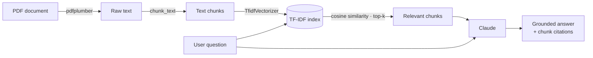

<p align="center">
  
</p>

<p align="center">
  <a href="https://www.python.org/"></a>
  <a href="https://www.anthropic.com/"></a>
  <a href="https://scikit-learn.org/"></a>
  <a href="https://docs.pytest.org/"></a>
  <a href="LICENSE"></a>
</p>

<p align="center">
  <b>A lightweight Retrieval-Augmented Generation (RAG) pipeline that answers questions about a PDF using only the content of the document and citing the passages it relied on.</b>
</p>

---

## Table of Contents

- [Overview](#overview)
- [Features](#features)
- [How It Works](#how-it-works)
- [Project Structure](#project-structure)
- [Getting Started](#getting-started)
- [Configuration](#configuration)
- [Usage](#usage)
- [Running Tests](#running-tests)
- [Design Decisions](#design-decisions)
- [Roadmap](#roadmap)
- [License](#license)

---

## Overview

**RAG Document QA** turns any text-based PDF into a question-answering source. It extracts the document's text, splits it into chunks, retrieves the passages most relevant to your question, and asks Claude to answer **strictly from those passages**, appending the chunk number(s) it relied on.

If the document doesn't contain the answer, the model is instructed to say so rather than guess.

## Features

| Capability | Description |
|---|---|
| **PDF ingestion** | Page-by-page text extraction with `pdfplumber`, with clear errors for missing files and image-only (scanned) PDFs. |
| **Chunking** | Fixed-size, word-based chunking with a configurable chunk size. |
| **Sparse retrieval** | TF-IDF vectorization and cosine similarity via scikit-learn. The index is built once and reused across queries. |
| **Grounded generation** | Claude answers using only the retrieved excerpts and declines to answer when the context is insufficient. |
| **Citations** | Every answer ends with its source chunk(s), e.g. `(Source: chunk 2)`. |
| **Centralized configuration** | Typed, validated settings loaded from environment variables or a `.env` file. |
| **Structured logging** | Timestamped, levelled logs across every stage of the pipeline. |
| **Test coverage** | Unit tests for ingestion, retrieval, and generation. The Claude API is mocked, so tests run offline. |

## How It Works



1. **Ingest** — `extract_text_from_pdf` reads every page and joins the text.
2. **Chunk** — `chunk_text` splits the text into ~`CHUNK_SIZE_WORDS`-word chunks.
3. **Index** — `ChunkRetriever` fits a TF-IDF vectorizer (English stop words removed) over all chunks.
4. **Retrieve** — the question is vectorized and the top `TOP_K_CHUNKS` chunks are ranked by cosine similarity.
5. **Generate** — `generate_answer` sends the labelled chunks and the question to Claude with a strict grounding system prompt.

## Project Structure

```text
RAG-document-qa/
├── src/
│   └── rag_qa/
│       ├── config.py           # Typed settings loaded & validated from env
│       ├── ingest.py           # PDF text extraction + chunking
│       ├── retrieve.py         # TF-IDF index & top-k retrieval
│       ├── generate.py         # Grounded, cited answers via Claude
│       └── logging_config.py   # Shared

