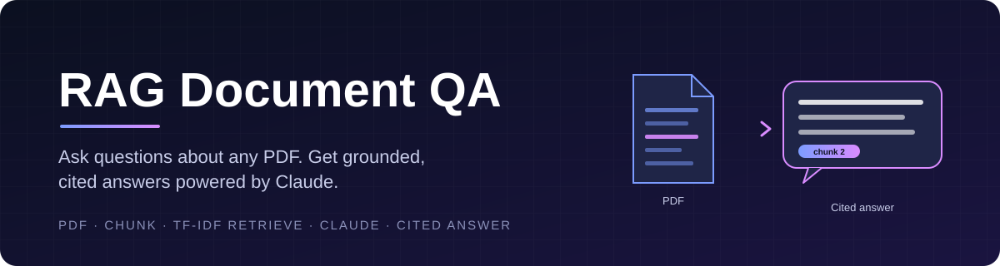
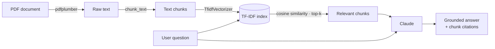

<p align="center">
  
</p>

<p align="center">
  <a href="https://www.python.org/"></a>
  <a href="https://www.anthropic.com/"></a>
  <a href="https://scikit-learn.org/"></a>
  <a href="https://docs.pytest.org/"></a>
  <a href="LICENSE"></a>
</p>

<p align="center">
  <b>A lightweight Retrieval-Augmented Generation (RAG) pipeline that answers questions about a PDF using only the content of the document and citing the passages it relied on.</b>
</p>

---

## Table of Contents

- [Overview](#overview)
- [Features](#features)
- [How It Works](#how-it-works)
- [Project Structure](#project-structure)
- [Getting Started](#getting-started)
- [Configuration](#configuration)
- [Usage](#usage)
- [Running Tests](#running-tests)
- [Design Decisions](#design-decisions)
- [Roadmap](#roadmap)
- [License](#license)

---

## Overview

**RAG Document QA** turns any text-based PDF into a question-answering source. It extracts the document's text, splits it into chunks, retrieves the passages most relevant to your question, and asks Claude to answer **strictly from those passages**, appending the chunk number(s) it relied on.

If the document doesn't contain the answer, the model is instructed to say so rather than guess.

## Features

| Capability | Description |
|---|---|
| **PDF ingestion** | Page-by-page text extraction with `pdfplumber`, with clear errors for missing files and image-only (scanned) PDFs. |
| **Chunking** | Fixed-size, word-based chunking with a configurable chunk size. |
| **Sparse retrieval** | TF-IDF vectorization and cosine similarity via scikit-learn. The index is built once and reused across queries. |
| **Grounded generation** | Claude answers using only the retrieved excerpts and declines to answer when the context is insufficient. |
| **Citations** | Every answer ends with its source chunk(s), e.g. `(Source: chunk 2)`. |
| **Centralized configuration** | Typed, validated settings loaded from environment variables or a `.env` file. |
| **Structured logging** | Timestamped, levelled logs across every stage of the pipeline. |
| **Test coverage** | Unit tests for ingestion, retrieval, and generation. The Claude API is mocked, so tests run offline. |

## How It Works



1. **Ingest** — `extract_text_from_pdf` reads every page and joins the text.
2. **Chunk** — `chunk_text` splits the text into ~`CHUNK_SIZE_WORDS`-word chunks.
3. **Index** — `ChunkRetriever` fits a TF-IDF vectorizer (English stop words removed) over all chunks.
4. **Retrieve** — the question is vectorized and the top `TOP_K_CHUNKS` chunks are ranked by cosine similarity.
5. **Generate** — `generate_answer` sends the labelled chunks and the question to Claude with a strict grounding system prompt.

## Project Structure

```text
RAG-document-qa/
├── src/
│   └── rag_qa/
│       ├── config.py           # Typed settings loaded & validated from env
│       ├── ingest.py           # PDF text extraction + chunking
│       ├── retrieve.py         # TF-IDF index & top-k retrieval
│       ├── generate.py         # Grounded, cited answers via Claude
│       └── logging_config.py   # Shared logger setup
├── tests/
│   ├── test_ingest.py
│   ├── test_retrieve.py
│   └── test_generate.py
├── assets/
│   └── banner.svg
├── .env.example                # Template for environment variables
├── pyproject.toml
├── requirements.txt
└── LICENSE
```

## Getting Started

### Prerequisites

- Python **3.10+**
- An [Anthropic API key](https://console.anthropic.com/)

### Installation

```bash
# Clone the repository
git clone https://github.com/vanshikatandxn/RAG-document-qa.git
cd RAG-document-qa

# Create and activate a virtual environment
python -m venv .venv
source .venv/bin/activate        # Windows: .venv\Scripts\activate

# Install dependencies and the package (editable)
pip install -r requirements.txt
pip install -e .
```

## Configuration

Copy the example environment file and add your API key:

```bash
cp .env.example .env
```

| Variable | Required | Default | Description |
|---|---|---|---|
| `ANTHROPIC_API_KEY` | Yes | — | Your Anthropic API key. |
| `CLAUDE_MODEL` | No | `claude-sonnet-4-5` | Claude model used for generation. |
| `CHUNK_SIZE_WORDS` | No | `250` | Approximate number of words per chunk. |
| `TOP_K_CHUNKS` | No | `2` | Number of chunks retrieved per question. |

> [!NOTE]
> `load_settings()` fails fast with a clear error if `ANTHROPIC_API_KEY` is missing.

## Usage

The pipeline is exposed as a small Python API. A complete end-to-end example:

```python
from rag_qa.config import load_settings
from rag_qa.ingest import extract_text_from_pdf, chunk_text
from rag_qa.retrieve import ChunkRetriever
from rag_qa.generate import generate_answer

settings = load_settings()

# 1. Ingest and chunk the document
text = extract_text_from_pdf("policy.pdf")
chunks = chunk_text(text, settings.chunk_size_words)

# 2. Build the retrieval index once
retriever = ChunkRetriever(chunks)

# 3. Ask questions
question = "What is the refund window?"
top_chunks = retriever.retrieve(question, top_k=settings.top_k_chunks)

answer = generate_answer(
    question,
    top_chunks,
    api_key=settings.anthropic_api_key,
    model=settings.claude_model,
)
print(answer)
```

**Example output**

```text
The refund window is 30 days from the date of purchase. (Source: chunk 1)
```

## Running Tests

```bash
pip install pytest
pytest -v
```

The generation tests mock the Anthropic client, so **no API key or network access is required** to run the suite.

## Design Decisions

- **TF-IDF over dense embeddings.** Sparse retrieval is fast, free, needs no external embedding API, and is easy to reason about; a well-established baseline that keeps the system transparent.
- **Fixed-size chunks without overlap.** A deliberate simplification for this scope. Production systems typically add ~10–20% overlap so answers near chunk boundaries aren't split.
- **Strict grounding prompt.** The model is told to use only the supplied excerpts and to admit when they're insufficient, reducing hallucinations and making every answer traceable.
- **Single source of configuration.** All environment access lives in `config.py`; business logic imports typed values instead of reading `os.environ` directly.
- **Logging, not `print`.** Every stage emits levelled, timestamped logs that can be redirected without touching business code.

## Roadmap

- Command-line interface for interactive Q&A
- Chunk overlap and sentence-aware splitting
- Hybrid retrieval (TF-IDF + dense embeddings)
- OCR fallback for scanned PDFs
- Multi-document support

## License

Distributed under the **MIT License**. See [`LICENSE`](LICENSE) for details.

Copyright © 2026 Vanshika Tandon.